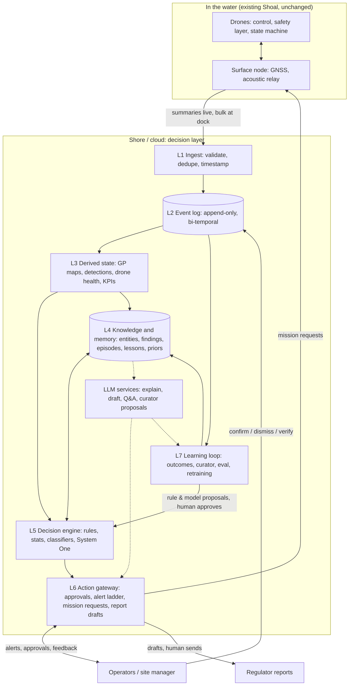

# Shoal decision layer: research and proposed structure

Status: research draft, 2026-11-27. No code yet.
Scope: the software layer that sits **on top of** the Shoal swarm (drones, surface node, mapping). It turns sensor data into decisions, actions and lasting knowledge, and gets better with every farm.

Evidence tags used below:
- **[n]** points to the source list at the end.
- **(SS)** means the figure came from a search summary; the page itself was not opened.
- **INFERENCE** means our own reasoning or arithmetic, not a sourced fact.
- **NOT FOUND** means we looked and found no source.

---

## 0. Summary

1. **The decision layer runs on shore and only advises.** The engineering overview already says safety and coverage run in the water, and the drones carry on if the link to shore drops. So everything here sends the swarm *mission requests*. Each request still passes through the on-drone safety layer and state machine. No LLM or hosted model sits in a control loop.
2. **Most decisions should not be made by an LLM.** In the decision inventory (§3), 14 of 18 decisions are handled by thresholds, statistics or a trained classifier, with no decision model or LLM involved. A small "System One" decision model, in the style of Jev or d1, handles narrow fuzzy judgements and memory linking. An LLM (Gemini, Claude) is used for explaining, reporting and proposing improvements. It is not used for raising alarms.
3. **"Sample more" is a first-class outcome.** When the system is unsure, the cheapest action is often to send a drone back to measure. This is the swarm version of PlugPilot's "test step", and it is something buoys and divers cannot do.
4. **Learning only works with outcome labels.** Every alert must end as *confirmed*, *dismissed* or *expired*, and every net finding must be confirmed or rejected by a diver/ROV check. Without that feedback row nothing improves. We design for it from day one.
5. **Memory comes in two scopes.** *Site memory* is per farm and per cage. *Fleet priors* are anonymised and shared across farms, and they are what makes farm #10 start better than farm #1. Sharing between customers needs consent written into the contract.
6. **Lead with the Danish pilot.** Danish (Lillebælt) trout sea farms have no sea-lice regime [28]. They do have a nutrient mass-balance permit regime built on feed and fish weight [27]. Our INFERENCE is that better feed efficiency therefore helps compliance. So feed waste and oxygen come first, then net integrity. Norway's lice and escape rules come in phase 2.
7. **Keep storage boring.** Use one Postgres database with an append-only, bi-temporal event log and a few typed tables. The "knowledge graph" is a node table and an edge table in the same database. Add a dedicated graph database only if queries actually need one.
8. **Preventive net risk is where memory pays off most (§5.5).** A hole can be found in one image. An area that is *about to* fail can't, because every early signal is a change over time: twine thinning since the last pass, wear counters, current and fouling load over days, old repairs. That makes net-risk scoring the clearest case for the memory layer.
   - The memory it needs is mostly structured history per net area (tables and counters). Agents add value at the edges: ingesting messy outside records and explaining scores.
   - **Pitch the outcome, not the mechanism:** "a risk map for every net area that gets sharper every week".

---

## 1. What we are building on (from the Shoal docs)

| Shoal produces | Arrives how | Notes for the decision layer |
|---|---|---|
| DO and temperature readings with position, position uncertainty and time | Live summaries over acoustic links, full logs at the surface or dock | **Data arrives late and out of order.** We store *event time* (when it was measured) separately from *ingest time* (when we got it). |
| 3D map per variable built with Gaussian-process regression (kriging), including a confidence map | Built on shore | The confidence map is the input to "where to sample next". |
| Inferred flow (drift residuals) | Shore, research-grade | Treat as low-confidence until validated. |
| Net video clips plus on-drone flags (holes, fouling, sagging) and feed pellets | Flags live, video at the dock | Detections need human verification before they become "facts". |
| Drone health (thruster current, battery, position uncertainty) | Live | A thruster-current spike probably means the prop is caught on the net (engineering overview §8.5). |

Constraints we keep (engineering overview §2, §8.6):
- If the shore link drops, the drones carry on.
- Hard limits (depth, distance to net, battery) always win over any learned policy.
- A simple state machine (deploy → survey → inspect → return/surface → dock) runs on the drone.

**What "action" means for us.** The system can:
- re-task the swarm (sample a zone, inspect a net panel),
- alert a person,
- draft a log entry or a regulator report.

It **cannot** run farm equipment such as feeders, oxygen diffusers or cranes. If we integrate with a feeding system later, that becomes a recommendation the operator accepts.

---

## 2. Domain research: what a sea-cage farm deals with

### 2.1 Farm basics

**Norway:**
- **Cages:** usually 157 m in circumference (about 50 m across) and up to about 50 m deep [11]. The legal maximum is 200,000 fish per cage and 25 kg/m³ [3].
- **Production cycle:** 12–24 months at sea from smolt to 4–5 kg, then at least 2 months fallow [9][3].
- **Sector size:** 995 salmon/trout sea sites and 8,108 grow-out employees in 2025, so roughly 8 staff per site (INFERENCE) [10].
- **Remote feeding centres are normal now.** Mowi Scotland feeds 18 sites with 12 staff using AKVA Observe pellet-detection AI [23]. Grieg fed 13 sites from one centre [22].
- **Daily routines required by law:**
  - inspection when the weather allows
  - daily removal of dead fish
  - "systematic" oxygen and temperature measurement
  - daily records per cage of fish numbers, weight, mortality and feed [3]

**Denmark (pilot market):**
- **Trout:** about 29% of Danish trout (28,375 t in 2021) is farmed at sea, with sea mortality around 6%. There is no official cause-of-death data [28].
- **Sites and permits:** 19 marine farms in 2024. A moratorium blocks new or expanded sea farms, and applications have been refused over nitrogen load (SS) [29][30].
- **Reporting, Danish order BEK 1178/2024** [27]:
  - a production plan 14 days before stocking
  - stock and feed reports for 1 June and 1 September
  - a daily feed log and an operations journal that includes maintenance and repair
  - disease needing medicine, escapes or extraordinary mortality reported within 7 days
  - an annual report by 15 February
  - nitrogen and phosphorus calculated by **mass balance** from feed and fish weight, where the planned feed conversion ratio may not be set lower than the farm's best of the last 3 years

  **INFERENCE:** proving that feed is not wasted is directly worth permit headroom. That makes the "feed waste" decision the strongest commercial wedge in Denmark, and it matches pitch slide 3.
- **Bottom-water oxygen:** southern Lillebælt was among the worst areas for low bottom-water oxygen (iltsvind) in July–August 2024 (SS) [31]. Whether that reaches cage depth is INFERENCE and needs checking.

**Mediterranean** (sea bream and sea bass) [33]:
- no sea lice
- temperatures up to around 28–30 °C are optimal and near the limits are risky
- EFSA's oxygen guideline is at least 40% saturation, and around 60% already affects immunity
- feeding is reduced or stopped above about 25–30 °C (SS) [35]
- main diseases: tenacibaculosis, vibriosis, *Sparicotyle* and nodavirus (SS) [34]

### 2.2 Risks and how big they are

| Risk | Scale | Where Shoal helps |
|---|---|---|
| Mortality overall (NO 2025) | 54.8 M salmon (14.2%) and 3.2 M trout (17.0%, rising) died at sea [1] | Logging when and where deaths happen, with environmental context |
| Injuries from handling and delousing | Ranked the #1 welfare problem 8 years running. About 4,000 non-medicinal treatment weeks in 2025. High temperature and low oxygen during handling raise mortality [1] | Pre-operation check of oxygen and temperature in the whole cage |
| Gill disease | #2 cause of mortality [1] | Indirect only: oxygen stress and net-washing waste (SS) [18] |
| Low oxygen | Below 30% saturation measured in large cages in weak current. Oxygen falls as water crosses the cage. Fish crowd locally at 1.5–5× nominal density [11] | **Core.** This is the direct case for mapping the whole cage instead of one buoy |
| Harmful algae | 2019 *Chrysochromulina*: 7.5 M fish. 2025: about 2 M. Cell counts correlate poorly with mortality [1]. Danish Skagerrak *Pseudochattonella* bloom in 2025 [1] | Early warning from oxygen and behaviour anomalies; we don't measure algae directly |
| Jellyfish | About 75% of the "environmental" mortality category in 2024 [1] | Camera detection is possible but unproven |
| Escapes | 223 notifications in 2025, mainly linked to *work operations* (lice treatment, equipment, net holes, propellers) [7]. Net holes historically the #1 cause (SS) [17] | **Core.** Net inspection around operations |
| Rising temperature and falling deep-water oxygen | Above 16 °C challenges salmon. Western-fjord deep-water oxygen down about 15% in 30 years [1] | Long-term site baselines |

### 2.3 Maintenance and inspection rules

- **Net inspection (NO):**
  - Nets must be checked before use and "regularly" [3].
  - Since 2022, nets must also be monitored **before, during and immediately after** every operation with escape risk [6].
  - How often is set by the farm's risk assessment plus the net manual's minimum [6]. **There is no fixed legal interval.**
  - **INFERENCE:** this makes "inspect after operation X" a natural trigger rule for the swarm.
- **Escape-risk deviations** go to the authorities immediately (NYTEK23 §44, regulation §38) [5][3]. The net service card is due within 24 months, and damaged nets must be repaired promptly [5].
- **Net cleaning:**
  - Done up to weekly, with 1–2 week cycles during the July–November hydroid peak (SS) [18].
  - Washing wears the net coating and may harm gills (SS) [18].
  - A trigger of about 40% fouling cover has been suggested (SS) [18].
- **Lice (NO only):**
  - weekly counts per cage
  - limit below 0.5 adult females per fish, and below 0.2 in spring weeks
  - treatment prescribed by a vet [4][16]
  - Out of scope for our sensors.
- **NOT FOUND:**
  - ROV or diver inspection costs (needed for our pricing claim)
  - a recurring or post-storm interval for mooring inspection
  - any source on alarm fatigue
  - any farmer survey of needs

### 2.4 What farms say they need (weakly sourced)

- **Fragmented systems, manual steps, little real-time use.** There is no "common data language" across vendors [20]. AquaCloud, the industry data-sharing initiative, went bankrupt in January 2026 [20].
- **Better decisions, not more data.** BCG puts the value in better decisions that combine sources, plus a shared "context layer" [21]. **INFERENCE:** that is exactly the layer this document describes.
- **Overloaded fish-health staff:** 75% have considered leaving, 43% citing workload [1]. **INFERENCE:** a product that adds alarms without cutting work will be rejected.
- **These claims rest on one seminar write-up and one consultancy piece.** The farm interviews (§10) have to confirm them.

---

## 3. Decision inventory

Our reading of the request is "where do decisions happen, and what kind of decider fits each one". The table lists every decision Shoal data can touch, ordered by pilot priority.

Decider codes:
- **R** = deterministic rule, versioned in code
- **S** = statistics / Gaussian process / anomaly model
- **C** = trained classifier (vision or tabular)
- **D** = typed System-One decision model (Jev, d1 or a local equivalent)
- **L** = LLM
- **H** = human

| # | Decision | Frequency | Who decides today | Our inputs | Criticality | Decider | Output |
|---|---|---|---|---|---|---|---|
| 1 | Is there a low-oxygen zone right now? | Continuous | Site manager, from 1 buoy | DO map, confidence, temperature, salinity | Welfare-critical | **R** on GP map plus hysteresis and sensor-health gate | Alert / sample more |
| 2 | Is the reading real or a sensor fault? | Every reading | Nobody | Sensor drift, neighbouring drones, probe history | Prerequisite for #1 | **S** (cross-drone consistency) + **R** | Flag sensor / sample more |
| 3 | Where should the swarm sample next? | Every mission cycle | — | GP uncertainty, rate of change, battery, localisation geometry | Economic | **S** (information gain) + **R** limits | Mission request |
| 4 | Is the oxygen trend heading for a crash in the next hours? | Hourly | Experience | Map history, temperature, time of day, feeding, season | Welfare-critical | **S** forecast → **R** threshold | Early warning |
| 5 | Should feeding be paused or reduced? | Every meal | Feeding operator | DO map, temperature, pellet detections, appetite | Economic + welfare [3] | **R** (low-DO stop) + **C** (pellets) → **H** | Recommendation |
| 6 | How much feed is being wasted? | Daily | Feed log only | Pellet detections, depth, position | Economic + **DK permit** [27] | **C** + **S** aggregation | Daily KPI, report line |
| 7 | Does this net clip show a hole / tear / sag / fouling? | Each inspection pass | Diver or ROV pilot | Video | Escape-critical | **C** (vision) | Detection with score |
| 8 | Is this detection a new finding or one we already know? | Each detection | — | Detection, net cell ID, past findings | Workflow | **D** (same-finding? yes/no) + **R** on geometry | Link or new finding |
| 9 | Should a net panel be re-inspected or repaired? | Per finding | Site manager | Finding severity, confirmations, upcoming operations | Escape-critical (NO: "promptly" [5]) | **R** severity matrix → **H** | Task + approval |
| 10 | Inspect after an operation (washing, delousing, crowding)? | Per operation | Required in NO [6] | Operation calendar, findings | Regulatory (NO) | **R** trigger | Mission request |
| 11 | Should the net be washed? | Weekly–monthly | Site manager | Fouling estimate trend, season | Economic + welfare | **C** (fouling %) + **R** (about 40%, SS) → **H** | Recommendation |
| 17 | Which net areas are most likely to fail next? (§5.5) | After each inspection pass, plus daily exposure updates | Nobody systematically; diver/ROV experience | Wear-sign detections, change since last pass, wear counters, current/fouling exposure, operations, net record | Escape-critical (prevention) | **R** + physics wear counters first; **S** (anomaly / time-to-failure) once labels exist | Risk map per net area, inspection priorities, recommendations |
| 18 | Turn outside records (cleaning-rig logs, repair notes, service-station reports) into structured events | Per record received | Paper and email today | PDFs, spreadsheets, emails | Feeds #17 and labels | **L** agent extracts → **H** spot-checks | `operation` / `repair` / `service_report` events |
| 12 | Is a handling operation safe to start now? | Per operation | Vet / manager | DO and temperature in the cage | Welfare-critical [1] | **R** go / no-go | Advisory check |
| 13 | Is fish behaviour abnormal (crowding, depth shift)? | Continuous | Camera watchers | Fish-density detections, depth distribution | Early warning (algae, oxygen, jellyfish) | **C** + **S** anomaly | Alert / sample more |
| 14 | Is a drone stuck on the net or failing? | Continuous | — | Thruster current, position uncertainty | Asset safety | **R** on drone (already designed) + **S** on shore for slow trends | Recover / maintenance task |
| 15 | Which incidents must go to the regulator, and what does the draft say? | Per incident | Manager, by hand | Incident record and evidence | Regulatory | **R** decides *whether*, **L** drafts *text* → **H** sends | Draft report |
| 16 | Why did this happen, and what should change? | Weekly / after incidents | Nobody, or a consultant | Event log, outcomes | Learning | **L** curator → **H** approves | Proposals (rule edits, new checks) |

**Out of scope** (not our sensors): lice counts, treatment choice, harvest timing, disease diagnosis. We can supply *context* to them, for example the pre-operation oxygen check in #12.

---

## 4. Choosing the decider

### 4.1 When to use what

| Decider | Use when | Don't use when | Examples above |
|---|---|---|---|
| **Rule in code** (thresholds, hysteresis, state machine) | A clear physical limit exists, it must be auditable, or a regulator asks "why" | The boundary is fuzzy or depends on context you can't list | #1, #9, #10, #12, #14 |
| **Statistics / Gaussian process / anomaly model** | Continuous fields, uncertainty, forecasting, drift | You need a category label | #2, #3, #4, #13 |
| **Trained classifier** (vision CNN/ViT, gradient boosting) | High volume, a stable label set, and labels can be collected | Few labels yet. Start with rules or a VLM to *create* labels, then train | #6, #7, #11, #13 |
| **Typed decision model** (Jev, d1, local "Laya", or a small fine-tuned model) | Narrow fuzzy yes/no or pick-one questions over text or structured context, where you want a probability and code applies the threshold [J3] | Arithmetic (it chooses well but calculates badly, per the BoligRadar lesson), or hard safety limits | #8, memory linking/typing, "is this note about net X?" |
| **LLM** (Gemini, Claude, …) | Explaining, summarising, drafting reports, proposing rule changes, answering operator questions over memory | Raising or suppressing alarms, any closed-loop control, anything needing a calibrated number | #15, #16, operator Q&A |
| **Agent** (LLM with tools) | Multi-step investigation: "why was cage 4 low last night?" pulls map history, feeding log, weather | Anything time-critical, or acting without approval | Weekly review, incident write-ups |
| **Human** | Anything that costs money, touches fish, or goes to a regulator | — | Approves #5, #9, #11, #15 |

**On "Gemini decision":**
- We read this as using an LLM such as Gemini as the decider.
- The recommendation is the same for any LLM: it explains and drafts, and it does not trigger alarms.
- A multimodal LLM *is* useful early as a **labelling assistant** for net video, producing the first labels that a dedicated classifier is later trained on.
- If you meant a specific Gemini product or feature, tell us and we will check it.

### 4.2 Lessons carried over from the earlier fleets (ai-for-entrepeneurs)

PlugPilot's pattern was "the VLM looks, System One judges, rules decide". For Shoal:
1. **Keep perception, judgement and decision as separate layers.** Detectors and the map emit typed facts with scores. Rules then decide, safety first, in a fixed order.
2. **Rules live in code, not in prompts.** In PlugPilot the live agent only had the rules as prose, and only the offline eval had them in code. Here, rules sit in one versioned module, and every decision records the rule version it ran.
3. **Fail closed when the model fails.** PlugPilot added "Rule 0" after its decision model failed and the agent invented probabilities. If a model or input is missing, the outcome is "human" or "sample more". It is never a made-up number.
4. **Use asymmetric thresholds.** The bar to warn is low; the bar to say "all clear" or to act is high.
5. **Give safety its own gate that can only tighten.** This follows BoligRadar's scam-shield and PlugPilot's safety-gate. The shore equivalent: a dismissed low-oxygen alert can't be dismissed again within a cooldown window if new readings are still low.
6. **Default thresholds will be wrong.** PlugPilot scored 14/48 with untuned thresholds and 39/48 after tuning, but on the same cases. Keep a held-out scenario set.
7. **Scope memory by class.** PlugPilot's memory got worse when patterns leaked across fault classes. Shoal patterns are keyed by *site × cage × variable × season*.
8. **Write how a question is worded down as config.** In BoligRadar a reworded question moved a score from 0.30 to 0.994. Treat question text like code: versioned and evaluated.
9. **New for Shoal: no approver is reachable underwater.** The earlier fleets assumed someone always answers in chat. Here the drones fall back to their own safe state, and shore escalates through the alert ladder in §5.7.

### 4.3 Jev-Mem in one paragraph

Jev-Mem (UT Dallas, arXiv 2609.23986, Sept 2026) works like this:
- A light **System One** model makes routine memory decisions: what type a memory is, which links to add, how to route a query, when retrieval has enough.
- The **System Two** LLM is called only to write the final answer.
- Memory is one node per observation with four overlaid relation views (semantic, temporal, causal, entity), plus vector and keyword indexes.
- Raw observations are never replaced; consolidation adds summaries on top.

Reported LoCoMo results: 0.777 vs 0.700 for the best baseline, 6.6× faster build, −37% query latency [J1].

Caveats:
- The results are self-reported on a single benchmark.
- The default controller is the hosted TypeSafe "Jev" API. The repo is MIT, but the controller is not.
- The repo lists a local alternative, Laya, that was not benchmarked [J2].
- Your earlier work already uses this pattern: BoligRadar's memory graph runs in Sheet tabs (`assignment-3/fleet/skills/memory-graph/SKILL.md`).

**Fit for Shoal:** use the *pattern*, not the library. Most Shoal memory is numeric and time-series, which belongs in tables and maps. The Jev-Mem pattern fits the **text and event side**: findings, incidents, operator notes, outcomes and lessons.

Related option: Graphiti/Zep keeps a *bi-temporal* knowledge graph. It records when a fact was true and when the system learned it, and it invalidates edges instead of deleting them (SS, docs not opened) [G1]. We copy that idea into the event log (§6.1) instead of adopting the product.

---

## 5. Proposed architecture



### 5.1 Layer contracts

| Layer | Input | Output | Never does |
|---|---|---|---|
| 1. Ingest | Raw packets and files from the surface node and dock | Validated `Event` rows | Drop late data (it is stored with its true `event_time`) |
| 2. Event log | Events | Single source of truth, append-only | Update or delete. Corrections are new events that point to the old ones |
| 3. Derived state | Event log | Maps (with confidence), detections, health, KPIs, each tagged with a version | Make decisions |
| 4. Knowledge | Derived state, outcomes, curator output | Entities, findings, episodes, lessons, priors | Hold raw time series (those stay in the log) |
| 5. Decision engine | Derived state and knowledge | `Decision` rows: inputs, scores, rule version, outcome type | Act directly |
| 6. Action gateway | Decisions | Alerts, approval requests, mission requests, report drafts | Bypass approval for actions that need it. Send anything to a regulator |
| 7. Learning | Decisions joined with outcomes | Tuned thresholds, retrained models, promoted lessons, proposals | Change rules or models in production without human approval and a passing eval |

### 5.2 Decision outcome types

Every decision ends in exactly one of these:

| Outcome | Meaning |
|---|---|
| `OK` | Nothing to do (logged, so we can measure false negatives later) |
| `SAMPLE_MORE` | Not sure: re-task a drone to get evidence. **This is the default when confidence is low and the swarm is available.** |
| `ALERT(level)` | A person needs to know |
| `RECOMMEND(action)` | A suggested farm action that needs human approval |
| `ESCALATE` | Input broken or model failed: a person must look |
| `MISSION_REQUEST` | Proposed swarm task, checked again by the on-drone safety layer |

### 5.3 Example: low-oxygen zone (decision #1) as code-level rules

**Illustrative only. Every threshold is a per-species, per-site config value, not a fact.**

```text
R0  inputs missing / map stale > N min / model error          → ESCALATE (never guess)
R1  sensor-health: reading disagrees with ≥2 neighbours or
    probe flagged drifting                                     → SAMPLE_MORE (cross-check) + flag sensor
R2  voxel DO < critical_low (any confidence)                   → ALERT(high)   [low bar to warn]
R3  voxel DO < warn_low AND GP confidence ≥ c_min
    AND persists ≥ T min (hysteresis)                          → ALERT(medium) + RECOMMEND(pause feeding in cage)
R4  voxel DO < warn_low AND confidence < c_min                 → SAMPLE_MORE (send nearest drone to the voxel)
R5  forecast(DO, +2h) < warn_low with p ≥ p_min                → ALERT(low, "early warning")
R6  else                                                       → OK
Clear an alert only after DO > warn_low + margin for ≥ T_clear (hysteresis)
```

Starting values to configure, with sources:
- **Salmon:**
  - long-term above about 7 mg/L [11]
  - the oxygen level needed for full appetite is 42–76% saturation over 7–19 °C [12]
  - tolerance limits of about 30/39/47/55% at 6/12/16/18 °C (SS) [13]
- **Trout (100 g, 15 °C):** appetite falls below about 6 mg/L and growth below about 7 mg/L (SS) [14].
- **Bream and bass:** EFSA guideline at least 40% saturation [33].
- **The "60% minimum" often quoted** comes from one company procedure (SS) [15]. It is not a rule.
- **Always store temperature and salinity with DO.** Converting mg/L to % saturation needs both.

### 5.4 Example: net hole (decisions #7 → #8 → #9)

**Illustrative only. All scores, cut-offs and time windows are made up to show the flow; they get tuned on real data.**

1. **On the drone:** the vision model flags a frame with `hole_score` = 0.62 and saves the clip.
2. **At the dock:** shore re-runs the larger model, giving `hole_score` = 0.71. The finding is located to a net cell ID ("panel 7" below) using net-relative positioning.
3. **System One:** asks "Is this the same defect as finding F-123 on panel 7?" A yes/no probability, combined with a geometry rule, decides whether to link it or create a new finding.
4. **Severity rule:** score ≥ 0.5 with an escape-capable size estimate → `ALERT(high)` plus `MISSION_REQUEST` (re-inspect panel 7 from two angles within 2 h). Score 0.3–0.5 → `SAMPLE_MORE`.
5. **Human verification:** the operator or a diver marks the finding *confirmed* or *false*. That label goes back into retraining and per-site threshold tuning.
6. **Report draft:** if confirmed and the site is in Norway, the LLM drafts the deviation report from the finding record. A person sends it [3][5].

### 5.5 Preventive net risk: find the weak areas before they become holes

Source: the team's research note *Preventive Net Damage Detection for Salmon Farm Pens* [N1] and the studies it cites. Its escape statistics are Norwegian, from 2006–2018 (the note says so itself). Check newer Fiskeridirektoratet figures, and the Danish trout situation, before using them externally.

**Why prevention, not just detection** [N1]:
- Net holes were the most common direct cause of escape incidents in 2010–2018 [N2].
- Contact between the net and the sinker-tube chain caused more than 50% of escaped fish in 2008–2010 [N3].
- Events of more than 10,000 fish were 19% of incidents but 91% of escaped fish (2006–2009) [N3]. A few big failures dominate, so catching one weak area early pays off a lot.
- Wear holes go through visible stages: contact or overload → coating wears off → twine frays and thins → meshes distort → one twine breaks → the hole grows. Each stage before the last is a chance to act.
- Sudden damage (predator bites, propeller strikes, handling accidents) can't be predicted this way. For example, spiny dogfish bite holes in nets along parts of the Norwegian west coast [N6]. Regular hole detection (§5.4) stays; real-time hole detection on ROV video already exists in research and pilots [N5].

**Model:** `risk(cell) = condition × exposure × consequence` [N1].
- **Condition** is how worn the netting already is in that area.
- **Exposure** is how much load, contact and handling the area gets.
- **Consequence** is how bad a hole there would be (depth, fish density nearby, how fast it could grow).

**Why this needs the memory layer.** Each input is history, not a snapshot:

| Signal | Kind of memory | Where it lives here |
|---|---|---|
| Twine thinning or meshes distorting **since the last pass** | Change detection per net cell | `NetCell` state history (§6.2), derived from detections |
| Cleaning passes, hours in contact with the weight system, load cycles | Wear counters, like a fatigue counter | Counters on `NetCell`, updated from `operation` and exposure events |
| Current and fouling drag over recent days (fouled nets measured at up to 12.5× the force of clean ones [N4]) | Time-integrated exposure | Event log plus the swarm's flow estimate |
| Old repairs (patch edges are weak points), net age, disinfectant treatments (−45% strength in SINTEF tests [N1]) | The net's own record | `NetRecord`, repair and treatment events |
| What actually failed at the end of the cycle | Labels | Service-station hole maps and strength tests [N1] |
| Lessons such as "after crowding, lower panels on the current side wear first" | Procedural / semantic memory | Knowledge graph (§6.3), promoted only after ≥ 2 verified outcomes |
| Patterns across farms by net material, cleaning regime and weight system | Fleet priors | §6.4, needs consent |

**Who decides what:**
1. **Day one, no labels:** rules and physics only.
   - Grid each net into cells by depth and angle.
   - Weight inspection toward known hotspots: bottom and cone, lower walls along weight ropes, waterline, seams, current-facing side, boat side, folds, old repairs [N1].
   - Keep wear counters per cell, and score change since the last pass.
2. **When labels arrive:** anomaly detection and time-to-failure models trained on repair logs and service-station records [N1]. Holes are rare, so this takes at least one net cycle (12–24 months). **The learned model is a year-2 story; pilot value has to come from step 1.**
3. **System One:** "is this the same spot as finding F-123?" when geometry alone is ambiguous (decision #8).
4. **LLM:** explains each high-risk cell with its evidence and drafts the recommendation. Example from the note: *"Pen 4, 12 m depth, 135°, outside. Risk: high. Contact with sinker tube chain for 40 hours this month, 14 cleaning passes, mesh distortion up since last inspection. Action: close inspection within 48 hours, check weight configuration."* [N1]
5. **Agent:** ingests outside records (decision #18). Cleaning-rig logs, repair notes and service-station reports sit with other companies, often as PDFs or spreadsheets.

**Recommendations it can produce** [N1]. All go to a person:
- close-up inspection or diver check
- adjust weights or the sinker tube to restore clearance
- change cleaning frequency, pressure or route in an area
- reinforce or repair
- plan an early net change

The swarm can do the first one itself as a `MISSION_REQUEST`.

**Why this suits Shoal specifically** (INFERENCE):
- **Change detection needs many revisits of the same spot.** A resident swarm can revisit cheaply and often; a monthly diver or ROV visit can't.
- **The swarm may already measure exposure.** The flow inferred from drone drift could supply the current input without an ADCP. The engineering overview calls inferred flow research-grade, so treat this as a hope until validated.
- **It matches Norwegian rules.** Net inspection frequency is set by the farm's own risk assessment [6]. A live risk map per net area *is* that risk assessment.

**Hard dependencies and risks:**
1. **Finding the same spot again.** The net moves and deforms. Without reliable net-relative positioning there is no change detection, and memory adds nothing [N1]. This is the same localisation problem the engineering overview calls the hardest one.
2. **Image quality.** Measuring fraying and twine thinning needs very close, sharp images, possibly laser or structured light [N1]. That pressures the cheap-drone design (about 3.4 L of hull buoyancy, limited power).
3. **Fish and fouling in the way.** Fish swim between the robot and the net, and fouling can hide a hole or look like one [N1].
4. **Data held by others.** Cleaning-rig, load-cell, boat-traffic (AIS) and service-station data belong to other companies [N1]. Integration and data-sharing deals are real work and may be refused.
5. **Few labels.** Holes are rare, and service-station records are not always digital or tied to a position on the net [N1].

### 5.6 Agent roles (where agentic AI fits)

These are shore-side agents in the style of the Fleet setups, separate from the decision engine. None of them is on the alarm path.

| Agent | Job | Tools: Auto | Tools: Ask (human approves) |
|---|---|---|---|
| **Investigator** | Answers "why was cage 4 low last night?" and writes incident timelines | Read event log, maps, knowledge graph, weather/tide data | — |
| **Report drafter** | Drafts regulator reports, the Danish annual report data and permit evidence packs | Read incidents and KPIs; write *drafts* | Send anything outside the company |
| **Curator** (nightly) | Consolidates memory, flags stale or contradicted facts, proposes rule/threshold/question changes from outcomes | Read everything; write proposals; write memory edges above the score threshold | Change a rule, threshold or model in production |
| **Operator assistant** | Q&A for the site manager over site memory | Read site-scoped data only | Create a mission request or task |

**Enforce permissions in the action gateway, not in prompts.** PlugPilot showed this. Its approvals came as typed Slack replies, and its least privilege was enforced only by prompt (subagents had the full Sheets toolset). Here, each agent gets its own credentials that can only reach its own tools. The gateway checks approvals against the approver's identity, and an approval expires if the evidence changes (the Commitment-Guardian pattern).

### 5.7 Alert ladder

Alert fatigue had no source (NOT FOUND), but the staff-overload data [1] makes it a design constraint anyway:
- **Levels:**
  - `info`: dashboard only
  - `low`: daily digest
  - `medium`: push notification with acknowledge
  - `high`: push notification, then a call if not acknowledged in X minutes
- **Every alert must be closed** as `confirmed`, `dismissed (reason)` or `expired`. That closing row is the learning label.
- **Measure it:** track alerts per site per week, and precision per rule. A rule whose precision falls below a set bar gets flagged for review by the curator.

---

## 6. Data and knowledge model

### 6.1 Event log (the system of record)

One append-only table. Every row has:
```text
event_id, event_type, site_id, cage_id, entity_ref,
event_time   (when it happened in the water)
ingest_time  (when shore received it)
valid_from / valid_to   (for facts that change, e.g. "net 3 installed" … "net 3 replaced")
source (drone_id / operator_id / model@version / rule@version)
payload (jsonb), supersedes_event_id (for corrections)
```
- `event_type` examples: `reading`, `detection`, `map_snapshot`, `decision`, `alert`, `action_request`, `approval`, `operator_note`, `operation` (washing/delousing/feeding), `outcome`, `correction`.
- Being **bi-temporal** lets us answer "what did we know at 03:00 when we raised that alert?". We need that for audits and for honest evaluation without peeking at the future.
- Bulk data (video, full logs) lives in object storage. The event log keeps the pointer and hash.

### 6.2 Entities (typed tables)

`Site`, `Cage`, `NetCell` (a grid on each net by depth × angle × inside/outside; holds the current risk score, wear counters and a pointer to its state history, §5.5), `NetRecord` (material, mesh and twine size, coating, days in sea, treatments, repairs, service-station results), `Drone`, `Sensor` (calibration history), `Zone` (voxel grid version), `Operation`, `Finding` (net defect, with lifecycle *suspected → confirmed / false → repaired*), `Incident` (a group of linked events), `Rule` (versioned), `Model` (versioned).

### 6.3 Knowledge graph (memory), Jev-Mem style but in Postgres

- **Nodes** are typed with the four Jev-Mem memory types:

  | Type | Shoal examples |
  |---|---|
  | **Episodic** | "Night of 2027-07-14: cage 4 dropped to 55% at 8–12 m after the evening meal, current < 2 cm/s" |
  | **Semantic** | "Cage 4 is in the lee of the island; low exchange at slack tide" · "Net 3 is 18 months old, copper-free coating" |
  | **Procedural** | Playbooks and rules: "after crowding, inspect lower panels first" |
  | **Preference** | Farm-specific choices: "manager wants feeding recommendations, not alerts, below medium" |

- **Edges:** `same_as`, `caused_by` (hypothesis, with a score), `precedes`, `located_at`, `about_entity`, `confirmed_by`, `contradicts`.
- **Who decides links:** System One proposes edges with a score. An edge is stored if the score is at least 0.6 (BoligRadar's value, to be tuned).
- **Consolidation:** a nightly job merges duplicate episodes into semantic facts. A fact is promoted only after **at least 2 verified outcomes**, as in PlugPilot's rule.
- **Nothing is deleted.** Old facts get `valid_to` set and a `contradicts` edge.
- **Every memory points back to its evidence** through `source_event_ids`. No memory exists without evidence.

### 6.4 Site memory vs fleet priors

| | Site memory | Fleet priors |
|---|---|---|
| Content | This farm's cages, nets, episodes, tuned thresholds, preferences | Anonymised patterns: "DO pockets form at slack tide in lee-side cages", vision model weights, default threshold sets per species/region, sampling strategies that worked |
| Used for | Decisions at this site | **Cold start for a new farm**, plus regional baselines |
| Who sees | That customer | All customers, aggregated |
| Needs | — | **Consent and a data clause in the subscription contract**. Aggregate before sharing; never share raw site data across customers |

This is the mechanism behind "new farms get a better product". Farm #N starts with:
- fleet-trained vision models,
- per-species and per-region thresholds tuned on earlier farms,
- a library of playbooks.

It then adapts to its own site memory within weeks.

---

## 7. Learning loop: what actually improves, and how

| What improves | Signal (label) | Method | Guard |
|---|---|---|---|
| Alert thresholds per site | Alert closed as confirmed / dismissed | Tune per rule to a target precision and recall on history | Safety rules may only get *more* sensitive without human sign-off |
| Net-defect vision model | Diver/ROV/operator verification of findings | Active learning: retrain on uncertain and wrong cases | Held-out set per site; never evaluate on training clips |
| Wear-sign detectors (fraying, thinning, mesh distortion, worn coating) | Close-up verification; later service-station inspection | Same as above | Separate eval per water clarity / lighting |
| Net-area risk model (§5.5) | Repair logs, confirmed holes, service-station hole maps and residual-strength tests at end of cycle | Start with physics-weighted rules; fit anomaly or time-to-failure models once ≥ 1 full net cycle of labels exists | Evaluate on held-out nets or cycles; always compare against the rules-only baseline |
| Pellet / feed-waste model | Operator spot checks, feed log vs biomass growth | Retrain; calibrate per camera and water clarity | — |
| GP map priors (length scales, means) | Readings over time | Fit hyperparameters per site and season | Version each map |
| Sampling strategy | Map error reduction per battery-minute (sim and real) | Compare strategies offline; RL later (team background) | On-drone limits always win |
| Forecast model (#4) | Real oxygen hours later | Retrain weekly; compare against a naive baseline | Use a forecast only if it beats the baseline on held-out weeks |
| System-One question wording | Linked or unlinked findings confirmed by people | Try rewordings, keep the best on the eval set | Wording is versioned |
| Lessons and playbooks | Incidents and outcomes | LLM curator proposes; human approves (the "knowledge factory" idea from the course) | At least 2 verified outcomes; scoped by class |

**Evaluation harness:**
- **Scenario set from the existing swarm sim.** Planted low-oxygen pockets, sensor drift, a hole on panel X, a drone stuck on the net. Run every rule and model change against it in CI.
- **Safety recall on planted critical cases must be 100%.**
- **Freeze the set.** Keep a held-out split that is never used for tuning (fixing PlugPilot's tuned-on-test issue).
- **Real data replaces synthetic data over time.** Each confirmed real incident becomes a regression case.
- **Log cost and latency per decision**, as PlugPilot did.

**Cold start, before any real data:**
- the simulator's synthetic oxygen and temperature fields
- public net-defect datasets, if licences allow (not yet checked)
- default thresholds from the literature (§5.3)
- tank tests

The sim is "kinder than a real cage" (engineering overview §7), so expect a re-tune after the first harbour and pilot data.

---

## 8. Suggested tech (minimal, swappable)

| Need | Pick | Why |
|---|---|---|
| Event log, entities, graph | **Postgres**. TimescaleDB extension if time series get big; `pgvector` for text memory search | One database to operate. The graph is two tables until queries prove otherwise |
| Bulk video and logs | Object storage (S3-compatible) | Cheap; the log holds the pointers |
| Maps | Python (GPyTorch / scikit-learn GP) as a versioned job | The team already plans Gaussian-process regression (engineering overview §6.3) |
| Rules | Plain Python module with typed inputs and outputs, unit tested, version stamped | Auditable; no rule engine needed yet |
| Vision | Same model family on drone and shore, different sizes | Engineering overview §8.5 |
| System One | Start with the hosted decision model you already know (d1 or Jev), behind an interface so a local model (Laya or a small fine-tune) can replace it | Avoids lock-in; required anyway if the link is poor |
| LLM | Any (Gemini, Claude), behind one interface, used only in the explain/draft/curate roles | Swappable; never on the alarm path |
| Interface to the swarm | ROS 2 messages or MAVLink mission items via the surface node, following the engineering doc's stack | Shore sends *requests*; the drone's state machine decides |
| Observability | Tracing every decision (LangSmith or OpenTelemetry) | Reuse the eval habits from the course |

---

## 9. First thin slice (buildable on sim data)

The goal is one full loop end to end before anything else is widened:

1. **Sim → events:** export synthetic DO and temperature readings from the swarm sim into the event log, with `event_time` and `ingest_time` (simulate late acoustic delivery).
2. **Map:** a GP map with a confidence map every N minutes, stored as a versioned `map_snapshot` event.
3. **Rules:** decision #1 (low-oxygen zone) with R0–R6 from §5.3, unit tested on 10 planted scenarios.
4. **Two outcomes wired:** `ALERT` goes to a simple dashboard or Slack. `SAMPLE_MORE` becomes a mission request that the sim actually executes.
5. **Feedback:** an acknowledge button with confirm/dismiss writes an `outcome` event.
6. **Eval script:** replays the scenario set and reports per-rule precision/recall, safety recall and time-to-detect.

The second slice adds net findings (#7–#9) with the finding lifecycle and System-One linking. In the sim, plant gradual wear (thinning, distortion that grows across passes) next to sudden holes, so net-area risk scoring (#17) can be tested with rules and wear counters before any real labels exist. The third slice adds the LLM curator, record ingestion (#18) and the weekly review.

---

## 10. Open questions

### For the team to decide
1. **Scope:** is this for the hackathon (demo the slice in §9 on sim data) or the actual v1.0 pilot architecture? The answer changes how much of §6–§8 to build now.
2. **Which decisions come first?** Suggested order: #1 low oxygen → #6 feed waste (the Danish permit angle) → #7–#9 nets → #17 net-area risk. Net risk is the strongest *memory* story and likely the biggest one for Norway, but it depends on net-relative positioning and close-up imaging. Do the farm conversations and the hardware roadmap support that order?
3. **Hosted or local models** for System One and the LLM? Hosted is faster to start. Local is better for data privacy and needed if the farm link is weak.
4. **Data-sharing terms:** will the subscription contract allow anonymised fleet priors (§6.4)?
5. **"Gemini decision":** did you mean a specific Gemini product or feature, or Gemini as a general LLM decider (as assumed here)?

### For the farm interviews (Dansk Akvakultur, Lillebælt farms, SDU)
1. Which decisions take the most of your time each week, and which ones do you feel least sure about?
2. When did low oxygen, feed waste or a net problem last cost you fish or money? How did you find out, and how late?
3. What does the permit and nutrient reporting cost you today in hours, and what data would make it easier or give you headroom?
4. How many alarms do you get a day today, and how many do you ignore?
5. Who would receive our alerts, by what channel, at night?
6. Which systems do you already use (feeding, journal, Fishtalk, Excel)? Would you want our data pushed into them?
7. How often are nets inspected and washed, by whom, and at what cost per visit? (We found no public cost figures.)
8. Would you share anonymised data so new sites start with better defaults? What would you need in return?
9. Where on your nets do holes usually appear (bottom, weight ropes, waterline, boat side)? Are they mostly wear or sudden damage?
10. Which net service company do you use? Do you get hole maps or strength tests back, and would they share them with us?
11. Do your cleaning rigs log position, passes and pressure? Which current, tension or sonar sensors are already installed? (Open questions from [N1].)

---

## Sources

Domain (gathered by a research pass on 2026-11-27; NO = Norwegian, DK = Danish):

- [1] Norwegian Veterinary Institute, Fish Health Report 2025 — https://www.vetinst.no/rapporter-og-publikasjoner/rapporter/2026/fish-health-report-2025/_/attachment/inline/4e7d310d-0620-439c-a2cf-caac02253620:b124880858959e1f6b61fbe45e1137e7e31fc0f9/Fish%20Health%20Report%202025.pdf
- [3] Akvakulturdriftsforskriften (NO) — https://lovdata.no/dokument/SF/forskrift/2008-06-17-822 (§ numbers taken from automated extraction; a new regulation is in consultation, so check them before hard-coding)
- [4] Lakselusforskriften (NO) — https://lovdata.no/dokument/SF/forskrift/2012-12-05-1140
- [5] NYTEK23 (NO) — https://lovdata.no/dokument/SF/forskrift/2022-08-22-1484 (§ numbers also taken from automated extraction; check them)
- [6] Fiskeridirektoratet, guidance sheet on inspection frequency — https://www.fiskeridir.no/Akvakultur/erfaringsbase-romming/fagstoff1/krav-til-inspeksjonsfrekvens/_/attachment/inline/5b43a0bb-aa3e-49cc-b177-d2809618df46:bda2947cd90bdda48eedb3d6e8abe944b9195159/Rettleiingsark%20-%20Krav%20til%20inspeksjonsfrekvens%20er%20knytt%20til%20risiko%20for%20r%C3%B8mming.pdf
- [7] Fiskeridirektoratet, escape year 2025 — https://www.fiskeridir.no/akvakultur/erfaringsbase-romming/fagstoff1/opptak-av-webinar-om-rommingssikkerhet/_/attachment/inline/e0f6b42d-1440-4775-a0df-3491352b4a89:31beba1ad78d3a4f9803ea486a739c5f3ef08746/R%C3%B8mmings%C3%A5ret%202025.pdf
- [9] Mowi Salmon Farming Industry Handbook 2026 — https://mowi.com/wp-content/uploads/2026/06/2026-salmon-farming-industry-handbook.pdf
- [10] Fiskeridirektoratet key figures 2025 — https://www.fiskeridir.no/statistikk-tall-og-analyse/data-og-statistikk-om-akvakultur/statistiske-publikasjon-innen-akvakultur/_/attachment/inline/5b1d40cc-194f-4547-a2f9-647495288e0f:087ee6f9ce030c8c2a69a9f9d4b00f112bfc643a/nokkeltall-havbruk-2025.pdf
- [11] Institute of Marine Research (Havforskningsinstituttet), "Store merder" memo to Mattilsynet — https://www.hi.no/resources/Store-merder-Mattilsynet-v2.pdf
- [12] https://agris.fao.org/search/fr/records/65df071c7c7033e84bec940b
- [13] (SS) https://agris.fao.org/search/fr/records/6748de767625988a3721439a
- [14] (SS; host unreachable) https://norceresearch.brage.unit.no/norceresearch-xmlui/bitstream/11250/2674446/1/Report%20RF%202005-056.pdf
- [15] (SS) company procedure on Namsos municipality site — https://namsos.kommune.no/_f/i8674a76e-e07b-41c8-8675-fb0f675562b6/maling-av-oksygen-i-sjoanlegg-prosedyre.pdf
- [16] Mattilsynet on sea-lice control — https://mattilsynet.no/fisk-og-akvakultur/fiskesykdommer/lakselus/fakta-om-lakselusbekjempelse
- [17] (SS) https://phys.org/news/2013-02-primarily-equipment-failure.amp
- [18] (SS) https://link.springer.com/article/10.1007/s10499-024-01482-8 · https://www.frontiersin.org/articles/10.3389/faquc.2023.1125595/full
- [20] Baird Maritime on aquaculture data strategy — https://www.bairdmaritime.com/fishing/aquaculture/industry-aquaculture-lacks-common-data-strategy-as-ai-use-expands
- [21] BCG 2026, Digitalizing salmonid farming — https://www.bcg.com/publications/2026/digitalizing-salmonids-farming-the-why-what-and-how
- [22] Salmon Business on Grieg's remote centre — https://salmonbusiness.com/hypothetically-we-could-run-griegs-whole-operation-from-here/
- [23] Global Seafood Alliance on Mowi's remote feeding — https://www.globalseafood.org/advocate/remote-feeding-center-leads-to-record-feed-efficiency-for-top-salmon-producer/
- [27] BEK 1178/2024 (DK) — https://www.lovtidende.dk/api/pdf/245689
- [28] DTU Aqua report 474-2024, animal welfare in Danish fish farming — https://www.aqua.dtu.dk/-/media/institutter/aqua/publikationer/rapporter-451-500/474-2024-animal-welfare-in-denmarks-fish-farming-sector-regulatory-and-practical-aspects.pdf
- [29] EU aquaculture country page, Denmark — https://aquaculture.ec.europa.eu/country-information/denmark
- [30] (SS) Miljøstyrelsen refusal, Kattegat offshore — https://mst.dk/media/avsgfkvh/20230321-kattegat-offshore-d-afslag.pdf
- [31] (SS; note number not verified) DCE/Aarhus University note on bottom-water oxygen — https://dce.au.dk/fileadmin/dce.au.dk/Udgivelser/Notater_2024/N2024_57.pdf
- [33] EU guide to Mediterranean fish welfare — https://aquaculture.ec.europa.eu/system/files/2023-08/HAPO%20mediterranean%20fish%20welfare%20guide.pdf
- [34] (SS) https://imbbc.hcmr.gr/wp-content/uploads/2020/12/2020-Rigos-RIAqua-56.pdf
- [35] (SS) https://www.frontiersin.org/journals/marine-science/articles/10.3389/fmars.2021.717360/full

Preventive net risk (§5.5):
- [N1] *Preventive Net Damage Detection for Salmon Farm Pens*, team research note, 2026-11-27 (local PDF). It also cites SINTEF publications on net-cleaning wear, nylon strength after disinfectants, escape reduction (El-Not) and hole detection from video. Those links are in the note.
- [N2] SINTEF, causal analysis of escapes 2010–2018 — https://sintef.brage.unit.no/sintef-xmlui/handle/11250/2788133
- [N3] Phys.org on the SINTEF SECURE project (2013) — https://phys.org/news/2013-02-primarily-equipment-failure.amp
- [N4] Gansel et al., PLOS ONE 2015, drag of clean and fouled net panels — https://journals.plos.org/plosone/article?id=10.1371/journal.pone.0131051
- [N5] SINTEF and Njord Aqua, real-time hole detection (2024) — https://www.sintef.no/en/latest-news/2024/sintef-and-njord-aqua-technology-detects-even-small-holes-in-fish-cage-nets-in-real-time/
- [N6] NORCE, spiny dogfish interactions with Norwegian salmon farms, Frontiers in Aquaculture 2025 — https://www.frontiersin.org/journals/aquaculture/articles/10.3389/faquc.2025.1539610/full

Memory and deciders:
- [J1] Jev-Mem paper — https://arxiv.org/abs/2609.23986 (HTML: https://arxiv.org/html/2609.23986v1)
- [J2] Jev-Mem repo (MIT) — https://github.com/libingzheren/Jev-Mem
- [J3] Jev as a typed yes/no judge for RAG — https://blog.dailydoseofds.com/p/jev-for-rag-clearly-explained
- [G1] (SS) Graphiti temporal knowledge graph — https://github.com/getzep/graphiti · https://mintlify.com/getzep/graphiti/concepts/temporal-model

Internal:
- ABYSS Robotics Pitch (pdf/pptx) and *Shoal – Engineering Overview v2*.
- `~/Desktop/ai-for-entrpeneurs`: final-project (PlugPilot), assignment-3 (BoligRadar), assignment-2 (LabMate), Commitment-Guardian, and the course lecture notes.
